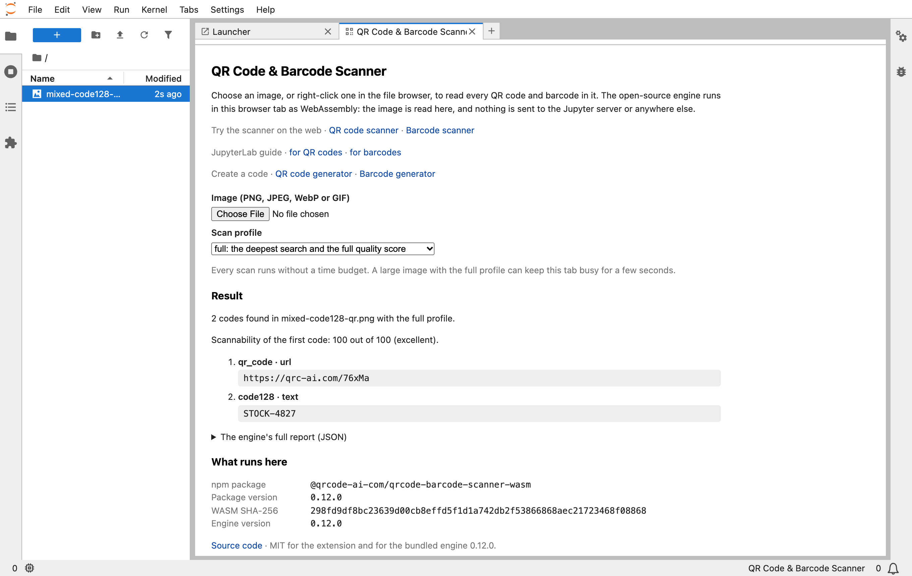

# JupyterLab Extension Manager listing: jupyterlab-qrcode-barcode-scanner

What JupyterLab's Extension Manager reads for this extension, where each value comes from, and
the owner's steps to publish it. Version 0.1.0 has been on PyPI since 24 November 2026, from the
tag `jupyterlab-v0.1.0`.

Since JupyterLab 4, the Extension Manager reads its catalogue from PyPI and installs with pip; the
`install.json` of the installed extension tells it which Python package to update or uninstall.
There is no submission form and no review. JupyterLab 4.0 to 4.6, 4.7.0b0 and 4.7.0b1 build that
catalogue by asking PyPI's XML-RPC `browse` method for every project with the classifier
`Framework :: Jupyter :: JupyterLab :: Extensions :: Prebuilt`. PyPI has removed that method: on
24 November 2026 it answered the call with the fault "PyPI no longer supports the XMLRPC browse
method", and the manager's search fails
([jupyterlab/jupyterlab#19932](https://github.com/jupyterlab/jupyterlab/issues/19932), open).
4.7.0b2 lists only language packs. JupyterLab's `main` branch, for 4.7.0, lists a fixed set of
known extensions and looks up a prebuilt extension whose exact project name is typed
([jupyterlab/jupyterlab#20511](https://github.com/jupyterlab/jupyterlab/pull/20511)); no release
held that change on 24 November 2026. Until a release does, pip is the install route.

## Why a prebuilt extension

The Extension Manager installs Python packages that carry a built frontend. A kernel-side widget
would be a library to import in a notebook, not something the manager lists. The extension is
therefore a prebuilt labextension: one `py3-none-any` wheel whose frontend bundles the published
browser engine `@qrcode-ai-com/qrcode-barcode-scanner-wasm@0.12.0`. It needs no rebuild of
JupyterLab, no Node.js on the user's machine, no server extension and no kernel. The scan runs in
the browser tab.

## The package

| Field | Value |
|---|---|
| PyPI project | `jupyterlab-qrcode-barcode-scanner` |
| Version | 0.1.0, tag `jupyterlab-v0.1.0` |
| Labextension | `@qrcode-ai-com/jupyterlab-qrcode-barcode-scanner`, installed to `share/jupyter/labextensions/` by the wheel; not published to npm |
| Engine | `@qrcode-ai-com/qrcode-barcode-scanner-wasm@0.12.0`, bundled; module SHA-256 `298fd9df8bc23639d00cb8effd5f1d1a742db2f53866868aec21723468f08868`, the one `distribution/releases/v0.12.0.json` records |
| Licence | `MIT`: the extension's code and the bundled engine 0.12.0, whose two rxing-derived reader parts keep their Apache-2.0 notices ([LICENSE-NOTES.md](LICENSE-NOTES.md)) |
| Wheel | `jupyterlab_qrcode_barcode_scanner-0.1.0-py3-none-any.whl`, about 1 MB |
| sdist | `jupyterlab_qrcode_barcode_scanner-0.1.0.tar.gz`, with the built labextension |

With engine 0.11.0, before the move to engine 0.12.0, the workflow `integration-jupyterlab` built
pull request #143 at head `637393f9` (merge commit `c7500ff0`) in
[run 44895450468](https://github.com/qrcode-ai-com/qrcode-barcode-scanner-rust/actions/runs/44895450468),
checked both files with `twine check --strict`, uploaded them as the artifact `jupyterlab-dist`
and printed:

```text
9dbef94d36faf9307ecc1c3f2f30cc1d5d7a5ec114c1562fbb5cdf982d23cd60  jupyterlab_qrcode_barcode_scanner-0.1.0-py3-none-any.whl
9c078315351c5282f5b2ff9dfe567e532ced9a2a3e499b30adf8a408ec1bfd00  jupyterlab_qrcode_barcode_scanner-0.1.0.tar.gz
```

The same run installed that wheel with JupyterLab 4.6.6 in a new environment, scanned the mixed
fixture through the panel with the three profiles and from the file browser, and closed its
receipt with the verdict PASS after the uninstall.

These are the digests of that commit's build. The wheel takes the dates of its entries from its
commit, so the tag's run builds other bytes; the run prints the digests it uploads, and those are
the ones PyPI must serve.

## What the listing reads

| Extension Manager or PyPI field | Value | Source |
|---|---|---|
| Name | `jupyterlab-qrcode-barcode-scanner` | `pyproject.toml` `name` |
| Summary | Read QR codes and barcodes in JupyterLab: a panel that scans an image in the browser with the open-source QR Code & Barcode Scanner engine. | `package.json` `description` |
| Description (PyPI) | this folder's README, with every image and link by absolute URL | `pyproject.toml` `readme` |
| Version | 0.1.0 | `package.json` `version` |
| Authors | Thibaut Mélen, Nicolas Cella | `pyproject.toml` `authors` |
| Licence | MIT | `pyproject.toml` `license` |
| Classifiers | Framework :: Jupyter :: JupyterLab :: 4, Extensions :: Prebuilt and their parents | `pyproject.toml` `classifiers` |
| Python | >= 3.9; no Python dependency, JupyterLab 4 is the user's | `pyproject.toml` |
| Homepage | <https://qrcode-ai.com/en-US/qr-code-scanner/integrations/jupyterlab> | `[project.urls]` |
| Source | <https://github.com/qrcode-ai-com/qrcode-barcode-scanner-rust/tree/main/integrations/jupyterlab> | `[project.urls]` |
| Bug Tracker | <https://github.com/qrcode-ai-com/qrcode-barcode-scanner-rust/issues> | `[project.urls]` |
| Package to manage | `jupyterlab-qrcode-barcode-scanner`, with pip | `install.json` |

The privacy, terms and support pages are live after the owner's review:
<https://qrcode-ai-com.github.io/privacy/>, <https://qrcode-ai-com.github.io/terms/> and
<https://qrcode-ai-com.github.io/support/>. The package metadata does not name them: the metadata
of a PyPI release cannot change after its upload.

## Screenshot



`media/scanner-panel.png` is a real JupyterLab 4.6.6 in Chrome 158, 1360 by 860 at device scale 2,
with this extension's wheel, bundling engine 0.12.0, installed in a new environment, on
24 November 2026. `tests/file-browser.mjs` right-clicked the sample in the file browser, chose
**Scan for QR codes and barcodes**, switched the profile to `full`, checked that both codes were
listed and saved the page; JupyterLab's news prompt was turned off for the picture, and the PNG
was reduced to 256 colours.

## The owner's steps

Steps 2 and 3 were in place when the GitHub API was read on 24 November 2026: the environment
`pypi-jupyterlab` has the owner as its required reviewer, no administrator bypass, no secret, no
variable and the one deployment rule `jupyterlab-v*` (tag), and `refs/tags/jupyterlab-v*` is in
the ruleset `distribution-tags-maintainer-only`. Step 1 is on PyPI and cannot be read from the
repository; the upload of 0.1.0 through it shows that it was in place. The tag `jupyterlab-v0.1.0`
and the PyPI project have existed since 24 November 2026.

### Once

1. **The PyPI pending publisher.** Sign in to <https://pypi.org> as the account that will own the
   project, open **Your account**, then **Publishing**. Under **Add a new pending publisher**,
   choose **GitHub** and enter:

   | Field | Value |
   |---|---|
   | PyPI Project Name | `jupyterlab-qrcode-barcode-scanner` |
   | Owner | `qrcode-ai-com` |
   | Repository name | `qrcode-barcode-scanner-rust` |
   | Workflow name | `python-plugins-publish.yml` |
   | Environment name | `pypi-jupyterlab` |

   In that workflow, `jupyterlab-build` builds and judges the two files on every run, and
   `jupyterlab-publish` uploads them on a `jupyterlab-v*` tag only, in that environment
   (RELEASING.md § Python plugin packages).

   Press **Add**. The first upload from that workflow and environment creates the project.

2. **The environment.** In the repository, open **Settings**, **Environments**, **New
   environment**, and name it `pypi-jupyterlab`. Under **Deployment protection rules**, tick
   **Required reviewers**, add the owner, and leave **Allow administrators to bypass** unticked.
   Under **Deployment branches and tags**, choose **Selected branches and tags**, then **Add
   deployment branch or tag rule**, ref type **Tag**, pattern `jupyterlab-v*`. Add no secret and no
   variable. Press **Save protection rules**.

3. **The tag rule.** Open **Settings**, **Rules**, **Rulesets**, then the ruleset of distribution
   tags. Under **Target tags**, **Add target**, **Include by pattern**, enter `jupyterlab-v*` and
   save.

### Each release

4. **The release commit.** Before the tag, merge a change to `main` that turns the README's
   **Status** into the published wording and gives in **Install** the way a published extension
   installs, pip with the project name. Name JupyterLab's Extension Manager only as a route that
   depends on its PyPI search, as the top of this file explains. The README is
   the PyPI description of the version: it cannot change once uploaded. Check that the Homepage
   page answers. It answered 404 on 21 November 2026; the owner chose to release 0.1.0, with the
   MIT engine 0.12.0, under that Homepage, the definitive address, which goes live with the
   website's JupyterLab pages. Wait for `integration-jupyterlab` to pass on that pull request.

5. **The tag.** Tag the merged commit and push the tag:
   `git tag -a jupyterlab-v0.1.0 <commit> -m 'JupyterLab extension 0.1.0'`, then
   `git push origin jupyterlab-v0.1.0`.

6. **The run.** Open **Actions**, **Publish · Python plugins**, the run of that tag. When
   `jupyterlab-build` has passed, it prints the two digests. `jupyterlab-publish` waits: press
   **Review deployments**, tick `pypi-jupyterlab` and **Approve and deploy**. It checks the tag,
   re-inspects the two files, compares them with what PyPI serves and uploads them through OIDC.

7. **Read back PyPI.** Open <https://pypi.org/project/jupyterlab-qrcode-barcode-scanner/0.1.0/>.
   **Download files** lists the wheel and the sdist with the digests the run printed, and each
   file's **Provenance** names the workflow `python-plugins-publish.yml`.

8. **Read back the install.** In a new environment with JupyterLab 4, run
   `python -m pip install jupyterlab-qrcode-barcode-scanner`, check that
   `jupyter labextension list` shows `@qrcode-ai-com/jupyterlab-qrcode-barcode-scanner`, open
   JupyterLab, open the **QR Code & Barcode Scanner** card of the launcher and scan the sample:
   both codes are listed. The Extension Manager's search is not a read-back while it cannot reach
   PyPI's catalogue (see the top of this file). Once a JupyterLab release searches another way, try
   it there, and count the extension as listed only when it appears.

A file on PyPI is immutable. A mistake is a new extension version and a new tag.
