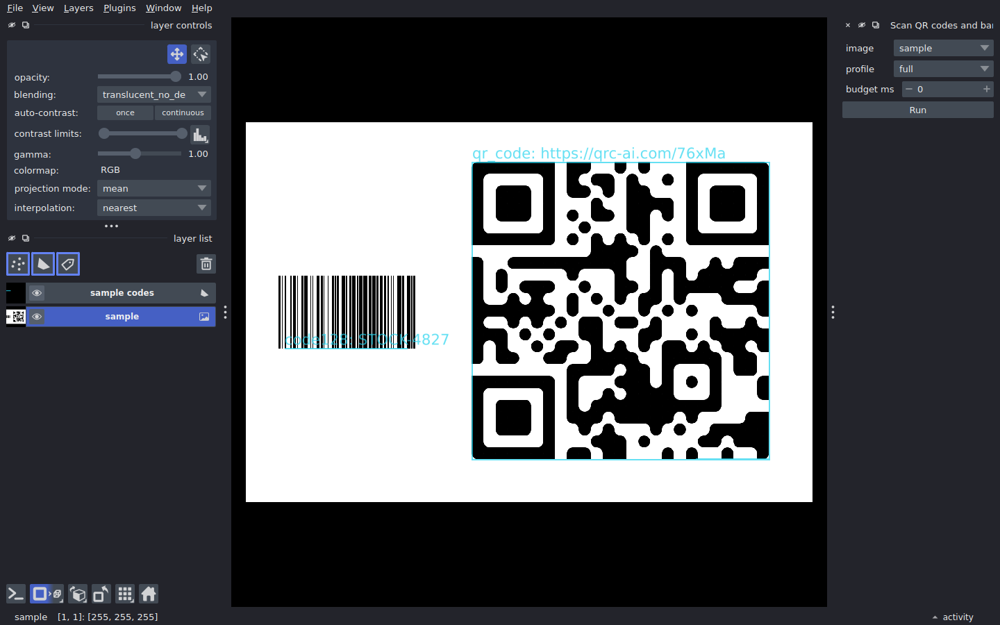

# napari hub listing: napari-qrcode-barcode-scanner

What the napari hub and napari's plugin manager show for this plugin, where each value comes from,
and the owner's steps to publish a version. Version 0.1.0, on engine 0.11.0, has been on PyPI since
22 November 2026, published from the tag `napari-v0.1.0`, and the napari hub listed it on
24 November 2026. Version 0.1.1, on the MIT engine 0.12.0, has been on PyPI since 24 November
2026, published from the tag `napari-v0.1.1`, and napari's plugin index served it when it was read
on 27 November 2026. Version 0.1.2, on the MIT engine 0.12.1, goes to PyPI from the tag
`napari-v0.1.2`; neither listing shows a version before PyPI serves it.

The napari hub lists a plugin that has a release on PyPI with the `Framework :: napari` classifier,
a valid npe2 manifest declared by the `napari.manifest` entry point and `visibility: public`. It
reads them from npe2api (`api.napari.org`), which rebuilds its index daily, and refreshes up to
every 4 hours. There is no submission form.

## The package

| Field | Value |
|---|---|
| PyPI project | `napari-qrcode-barcode-scanner` |
| Version | 0.1.2, tag `napari-v0.1.2` |
| Engine | `qrcode-barcode-scanner==0.12.1`, installed from PyPI as a dependency; the plugin does not bundle it |
| Licence | MIT (`License-Expression: MIT`, `LICENSE`); the engine wheel 0.12.1 is MIT too and ships its own `LICENSE` |
| Wheel | `napari_qrcode_barcode_scanner-0.1.2-py3-none-any.whl` |
| sdist | `napari_qrcode_barcode_scanner-0.1.2.tar.gz` |

Version 0.1.1 installed the MIT engine wheel 0.12.0. Version 0.1.0 installed the engine wheel
0.11.0, which keeps the licence it shipped with, AGPL-3.0-or-later. Before that release, the job
`napari` of `integration-python-hosts` built commit `3612ef3` of pull request #137 on CI
(run [44886529397](https://github.com/qrcode-ai-com/qrcode-barcode-scanner-rust/actions/runs/44886529397), 21 November 2026), checked both files with
`twine check --strict` and printed:

```text
e0074a12390d19b195bd29a583a5875658f9007fcbf810ed9783e473fdbe96e3  napari_qrcode_barcode_scanner-0.1.0-py3-none-any.whl
06523bc8963baa0a152b368887aa7a9baa73dab366d3afd0fa934336805a3acc  napari_qrcode_barcode_scanner-0.1.0.tar.gz
```

These are the digests of that commit's build. Each build of a commit puts the same entries, with
the same dates, in its wheel: a rebuild of `3612ef3` on macOS gave the same entries and other
compressed bytes, as its zlib differs. The sdist's archive dates change with each build. So the
tag's run builds other bytes, prints the two digests it uploads and uploads those very files: they
are the ones PyPI must serve. For 0.1.0, PyPI serves the files of the tag's run:

```text
e86fe7682296b6f7b3e2cbed1a29c5de804ea3e4898f8c43b586fa18f5d70db1  napari_qrcode_barcode_scanner-0.1.0-py3-none-any.whl
38ee01ca23d85a134c3c813a40dda6a2a119d80af6eea4800c9e789b1e1eee88  napari_qrcode_barcode_scanner-0.1.0.tar.gz
```

For 0.1.1, PyPI serves the files of the run of the tag `napari-v0.1.1`:

```text
9ffc6e39fc8fe66fdced7540c50cfdd3ed11dc3eb5ca720b7b76c2620b3b61a5  napari_qrcode_barcode_scanner-0.1.1-py3-none-any.whl
b64201dace7cbb6cc301bbfdc423fa9616126c4827dbf26f19fb3e190c3db37e  napari_qrcode_barcode_scanner-0.1.1.tar.gz
```

The run of the tag `napari-v0.1.2` prints the two digests of 0.1.2 the same way.

## What the listing reads

| Hub field | Value | Source |
|---|---|---|
| Name | `napari-qrcode-barcode-scanner` | `pyproject.toml` `name` |
| Display name | QR Code & Barcode Scanner | `napari.yaml` `display_name` |
| Summary | Read the QR codes and barcodes of a napari image layer with the QR Code & Barcode Scanner engine. | `pyproject.toml` `description` |
| Description | this folder's README, with every image and link by absolute URL | `pyproject.toml` `readme` |
| Visibility | public | `napari.yaml` `visibility` |
| Categories | Measurement, Utilities | `napari.yaml` `categories` |
| Contributions | the widget "Scan QR codes and barcodes" and its command | `napari.yaml` `contributions` |
| Authors | Thibaut Mélen, Nicolas Cella | `pyproject.toml` `authors` |
| Licence | MIT | `pyproject.toml` `license` |
| Python | >= 3.11 (napari 0.10 needs 3.11) | `pyproject.toml` `requires-python` |
| Operating systems | macOS, Windows, Linux | classifiers |
| Requirements | numpy >= 1.24, magicgui >= 0.8, qrcode-barcode-scanner == 0.12.1; napari and Qt are the user's | `pyproject.toml` `dependencies` |
| Homepage | <https://qrcode-ai.com/en-US/qr-code-scanner/integrations/napari> | `[project.urls]` |
| Documentation | <https://github.com/qrcode-ai-com/qrcode-barcode-scanner-rust/tree/main/integrations/napari> | `[project.urls]` |
| Source Code (the hub's GitHub link) | <https://github.com/qrcode-ai-com/qrcode-barcode-scanner-rust> | `[project.urls]` |
| Bug Tracker | <https://github.com/qrcode-ai-com/qrcode-barcode-scanner-rust/issues> | `[project.urls]` |

The privacy, terms and support pages are live after the owner's review:
<https://qrcode-ai-com.github.io/privacy/>, <https://qrcode-ai-com.github.io/terms/> and
<https://qrcode-ai-com.github.io/support/>. The package metadata does not name them: the metadata
of a PyPI release cannot change after its upload.

## Screenshot



`media/napari-window.png` is the window of a real napari 0.10.0, with PyQt6 6.12.1 on a virtual
display (xvfb, 1600 by 1000). The job `napari-window` of `integration-python-hosts` installed the
plugin's built wheel in a new environment, added its widget as the Plugins menu does, ran a `full`
scan of the mixed sample and checked that both codes were outlined before saving the window
(`tests/capture_window.py`). It comes from the same run, [44886529397](https://github.com/qrcode-ai-com/qrcode-barcode-scanner-rust/actions/runs/44886529397): 1440 by 900
pixels, sha256 `a047712e60529ebded32f47d336c8836b960952ae3e2970f258848628b146f9f`. That was version
0.1.0 on engine 0.11.0. With version 0.1.1 on engine 0.12.0, the same job of pull request #224
(run [45388448905](https://github.com/qrcode-ai-com/qrcode-barcode-scanner-rust/actions/runs/45388448905), 24 November 2026) saved a picture with the same sha256.

## The owner's steps

Steps 1 to 3 were done on 22 November 2026, and version 0.1.0 was published through them. The
pending publisher was added under the PyPI organization `qrcode-ai`, so the project the first upload
created belongs to that organization. When the GitHub API was read again on 24 and 27 November 2026,
the environment `pypi-napari` had the owner as its required reviewer, no administrator bypass, no
secret, no variable and the one deployment rule `napari-v*` (tag), and `refs/tags/napari-v*` was in
the ruleset `distribution-tags-maintainer-only`. A next version needs none of them again: it starts
at step 4.

### Once

1. **The PyPI pending publisher.** Sign in to <https://pypi.org> as the account that will own the
   project, open **Your account**, then **Publishing**. Under **Add a new pending publisher**,
   choose **GitHub** and enter:

   | Field | Value |
   |---|---|
   | PyPI Project Name | `napari-qrcode-barcode-scanner` |
   | Owner | `qrcode-ai-com` |
   | Repository name | `qrcode-barcode-scanner-rust` |
   | Workflow name | `python-plugins-publish.yml` |
   | Environment name | `pypi-napari` |

   Press **Add**. The first upload from that workflow and environment creates the project.

2. **The environment.** In the repository, open **Settings**, **Environments**, **New
   environment**, and name it `pypi-napari`. Under **Deployment protection rules**, tick
   **Required reviewers**, add the owner, and leave **Allow administrators to bypass** unticked.
   Under **Deployment branches and tags**, choose **Selected branches and tags**, then **Add
   deployment branch or tag rule**, ref type **Tag**, pattern `napari-v*`. Add no secret and no
   variable. Press **Save protection rules**.

3. **The tag rule.** Open **Settings**, **Rules**, **Rulesets**, then the ruleset of distribution
   tags. Under **Target tags**, **Add target**, **Include by pattern**, enter `napari-v*` and save.

### Each release

4. **The release commit.** Before the tag, merge a change to `main` that turns the README's
   **Status** into the published wording and adds to **Install** the two ways a published plugin
   installs: pip with the project name, and napari's **Plugins**, **Install/Uninstall Plugins**.
   The README is the PyPI description of the version: it cannot change once uploaded. Check that
   the Homepage page answers. It answered 404 on 21, 22, 24 and 27 November 2026; on 22 November the
   owner chose to release 0.1.0 with that Homepage, the definitive address, which goes live with the
   website's napari pages, and 0.1.1 and 0.1.2 keep it. Wait for `integration-python-hosts` to pass
   on that pull request.

5. **The tag.** Tag the merged commit and push the tag:
   `git tag -a napari-v0.1.2 <commit> -m 'napari plugin 0.1.2'`, then
   `git push origin napari-v0.1.2`.

6. **The run.** Open **Actions**, **Publish · Python plugins**, the run of that tag. When
   `napari-build` has passed, it prints the two digests. `napari-publish` waits: press **Review
   deployments**, tick `pypi-napari` and **Approve and deploy**. It checks the tag, re-inspects the
   two files, compares them with what PyPI serves and uploads them through OIDC.

7. **Read back PyPI.** Open <https://pypi.org/project/napari-qrcode-barcode-scanner/0.1.2/>.
   **Download files** lists the wheel and the sdist with the digests the run printed, and each
   file's **Provenance** names the workflow `python-plugins-publish.yml`. Installing version 0.1.2
   from PyPI in a new environment must install the engine wheel 0.12.1 with it.

8. **Read back the napari hub.** After npe2api's next daily build and up to 4 hours more, the
   plugin's page at <https://napari-hub.org/plugins/napari-qrcode-barcode-scanner> shows the new
   version, with the display name, the summary, the README and the GitHub link of the table above.

9. **Read back napari's plugin manager.** In napari 0.10.0, open **Plugins**, **Install/Uninstall
   Plugins**, search for `qrcode`, install **QR Code & Barcode Scanner** and restart napari. Open
   the sample image, then **Plugins**, **Scan QR codes and barcodes (QR Code & Barcode
   Scanner)**, and press **Run**: both codes are outlined.

A file on PyPI is immutable. A mistake is a new plugin version and a new tag.
